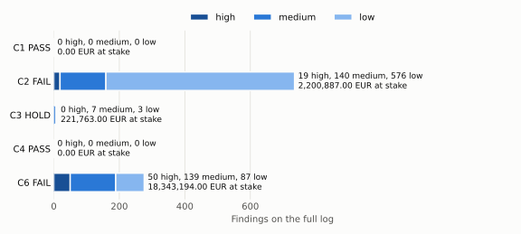
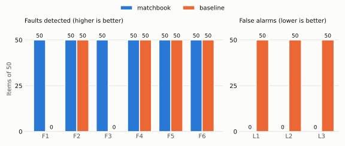
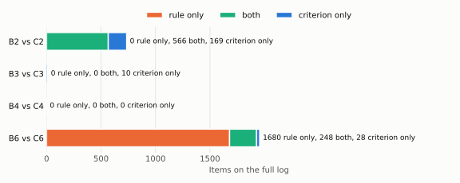

# matchbook

[](https://github.com/ikeramado/matchbook/actions/workflows/check.yml)

Purchasing reconciliation on a real-world procure-to-pay event log: for every purchase order
item, check that what was ordered, received and invoiced lines up under the item's matching
rule, and surface the items that don't.

> **Status:** v0.2.0. The document checks (C1 to C4), the amount check C6 and the date
> check (C7) run on the full log; C5 is deferred, see [CRITERIA.md](CRITERIA.md).

## Case study

**Situation.** A multinational pays suppliers when the order, the delivery and the invoice
agree. Nobody had checked whether that match actually holds across its 251,734 order lines.

**What I did.** I rebuilt the story of every line from the raw purchasing log, checked it
against its matching rule, and ranked every exception by the money at stake. Then I proved
the checks work: I planted 300 known errors and 150 legitimate look-alikes and measured
what was caught.

**Result.** 1,021 exceptions worth 20.8 M EUR to review, 69 of them high severity. All 300
planted errors caught with no false alarms; the usual spreadsheet rules missed 100 and
raised 150 false alarms.

**What this means for you.** If money depends on a data process (payments,
reconciliations, a model's predictions), I can tell you whether it does what it claims,
show it with numbers, and say what to keep, fix or replace.
[Upwork profile](https://www.upwork.com/freelancers/~018a26d02cfcd93639)

## The report on the full log

These blocks are copied from the diagnosis report on the full BPI Challenge 2019 log
(`python -m matchbook report`, see *Usage*); a test checks them against a fresh run.

The codes in this README, with their names (the exact conditions are in
[CRITERIA.md](CRITERIA.md) and the injected kinds in [BRIEF.md](BRIEF.md)):

| Code | Name |
| --- | --- |
| C1 | invoice before goods receipt |
| C2 | invoice cleared without goods receipt |
| C3 | invoice cleared without invoice receipt |
| C4 | consignment item invoiced |
| C5 | invoiced above ordered value |
| C6 | invoiced and received amounts differ |
| C7 | date outside the log's period |
| C12 | euros at stake |
| C13 | severity |
| C18 | control status and plan |
| C19 | report tables |
| C21 | README images |
| F1 | invoice moved before the goods receipt |
| F2 | goods receipts removed |
| F3 | goods receipt cancelled |
| F4 | invoice receipts removed |
| F5 | consignment item invoiced |
| F6 | invoice raised by 10% |
| L1 | receipt corrected |
| L2 | invoice corrected |
| L3 | delivery in two parts |

Each control, with its status (PASS: no findings; HOLD: findings, none high; FAIL: at least
one high finding), its findings and the euros at stake:

<!-- from the report -->
| Control | Status | Findings | EUR at stake |
| --- | --- | ---: | ---: |
| C1 | PASS | 0 | 0.00 |
| C2 | FAIL | 735 | 2,200,887.00 |
| C3 | HOLD | 10 | 221,763.00 |
| C4 | PASS | 0 | 0.00 |
| C6 | FAIL | 276 | 18,343,194.00 |
<!-- end -->

What to do with each control, and the finding that decides it:

<!-- from the report -->
- C1: keep.
- C2: replace, decided by 4507032353_00020 at 58,815.00 EUR, high.
- C3: fix, decided by 4507076029_00030 at 97,569.00 EUR, medium.
- C4: keep.
- C6: replace, decided by 4507007947_00010 at 5,977,303.00 EUR, high.
<!-- end -->

The findings by severity:

<!-- from the report -->
| Severity | Findings | EUR at stake |
| --- | ---: | ---: |
| high | 69 | 18,253,525.00 |
| medium | 286 | 2,302,469.00 |
| low | 666 | 209,850.00 |
<!-- end -->



On a copy of the log with 50 items of each known fault injected (F1 to F6) and 50 of each
legitimate look-alike (L1 to L3), the checks against a baseline of simple rules:

<!-- from the report -->
| Kind | Criterion | Items | Detected | False alarms | Baseline detected | Baseline false alarms |
| --- | --- | ---: | ---: | ---: | ---: | ---: |
| F1 | C1 | 50 | 50 | 0 | 0 | 0 |
| F2 | C2 | 50 | 50 | 0 | 50 | 0 |
| F3 | C2 | 50 | 50 | 0 | 0 | 0 |
| F4 | C3 | 50 | 50 | 0 | 50 | 0 |
| F5 | C4 | 50 | 50 | 0 | 50 | 0 |
| F6 | C6 | 50 | 50 | 0 | 50 | 0 |
| L1 |  | 50 |  | 0 |  | 50 |
| L2 |  | 50 |  | 0 |  | 50 |
| L3 |  | 50 |  | 0 |  | 50 |
<!-- end -->

The faults are injected by rules written with the same understanding as the checks, so
detecting them shows that each check catches its kind, not how many real faults the log
holds.



On the real log, each baseline rule against its criterion: the items flagged by the rule
only (the simple rule flags them, matchbook clears them), by both, and by the criterion only
(matchbook flags them, the rule misses them):



One real finding: item `4507032353_00020` breaks C2 with 58,815.00 EUR at stake, severity
high, and it is the finding that decides the replace of C2. Its goods receipt was recorded
on 2018-06-21 and cancelled on 2018-07-03; the invoice was cleared on 2018-09-06 with no
goods receipt in force:

| Activity | Timestamp | EUR |
| --- | --- | ---: |
| Record Goods Receipt | 2018-06-21T09:24:00+00:00 | 58815.0 |
| Cancel Goods Receipt | 2018-07-03T09:24:00+00:00 | 58815.0 |
| Clear Invoice | 2018-09-06T12:06:00+00:00 | 58815.0 |

## Limitations

- The log is public data from 2018: the BPI Challenge 2019 log, published for research;
  the findings describe that log, not a live process.
- The euros at stake are an amount to review, not a confirmed loss: a finding says that the
  documents of an item do not line up, and only the company's own records can say whether
  money was lost.
- The injected faults show that each check catches its kind, not how many real faults the
  log holds: they are injected by rules written with the same understanding as the checks.

## Goal

Accounts payable teams reconcile three documents before paying a supplier: the **purchase
order** (what was agreed), the **goods receipt** (what arrived) and the **invoice** (what is
being charged). matchbook reads the purchasing event log, rebuilds that story for each
purchase order item, and reports the items that break their matching rule: for example, an
invoice cleared without a goods receipt where one is required.

The scope is in [BRIEF.md](BRIEF.md) and the checkable conditions in
[CRITERIA.md](CRITERIA.md).

## Usage

Requirements: Python 3.14 and [uv](https://docs.astral.sh/uv/). Run `uv sync` once to
create the environment.

```bash
uv run python -m matchbook ~/matchbook-data/BPI_Challenge_2019.xes > findings.tsv
```

The command reads the log, never writes to its directory, and prints one tab-separated line
per finding on stdout. An item that breaks more than one criterion has one line for each.
The fields are:

1. the item (the case ID: purchase order and item number);
2. the criterion it breaks (for example `C2`);
3. the euros at stake, with two decimals (C12): for C1 the invoice receipt found with no
   goods receipt in force, for C2 and C3 the `Clear Invoice` found with no receipt in force,
   for C4 the first event of the evidence, for C6 the absolute net difference;
4. the severity (C13): `high` at 10,000 EUR or more, `medium` from 1,000 EUR, `low` below,
   one level lower (`low` stays `low`) for a finding with the reversal note of C2 and C3;
5. the events that broke it, separated by `; `, each as activity, timestamp and cumulative
   net worth in EUR;
6. a note, only when the finding carries one (C2, C3 and C6, see below).

Fields 3 and 4 are empty on C7 and `C6 not checked` lines: those are data quality, not
exceptions.

To count the findings per criterion:

```bash
uv run python -m matchbook ~/matchbook-data/BPI_Challenge_2019.xes | cut -f2 | sort | uniq -c
```

On the full log, `cut -f2,4` instead counts 69 high, 286 medium and 666 low findings: C2
19, 140 and 576; C3 0, 7 and 3; C6 50, 139 and 87.

The full log takes about 30 seconds on the development machine.

To write the diagnosis report (C18, C19) to a Markdown file outside the log's directory:

```bash
uv run python -m matchbook report ~/matchbook-data/BPI_Challenge_2019.xes report.md
```

The report gives each control (C1, C2, C3, C4, C6) a status on the log: PASS with no
finding, HOLD with findings and none high, FAIL with a high finding. Its plan keeps a PASS
control, fixes a HOLD control and replaces a FAIL control, naming the finding that decides
it: the one with the most euros at stake, among the high ones for FAIL. Then come the count
and euros of the findings per severity and per criterion, the table of
`python -m matchbook.score` on the injected log (`--seed`, 1 by default) and the table of
`python -m matchbook.compare`. The same log and seed give the same file. The command
refuses an output inside the log's directory. The full log takes about two minutes.

To draw the three images of the first section from a report into a directory (C21):

```bash
uv run python -m matchbook images report.md docs/images
```

The command reads only the report's tables; the same report gives the same files.

## Checks

The exact conditions are in [CRITERIA.md](CRITERIA.md). Items flagged is the count on the
full BPI Challenge 2019 log.

| ID | Flags | Items flagged |
|---|---|---:|
| C1 | A *3-way match, invoice after GR* item invoiced while no goods receipt is in force (before the first receipt, or after cancellations undid every receipt); open items with neither a receipt nor a clearing are left out | 0 |
| C2 | A 3-way match item (either kind) whose invoice is cleared while no goods receipt is in force; a note marks a clearing within 10 minutes after an invoice cancellation, which may clear the reversal rather than pay | 735 |
| C3 | A *2-way match* item whose invoice is cleared while no invoice receipt is in force, with the same note as C2 | 10 |
| C4 | A *Consignment* item with a cleared invoice, or an invoice receipt not undone by a cancellation | 0 |
| C5 | Invoiced value above the ordered value: deferred, the log holds no ordered total ([CRITERIA.md](CRITERIA.md#amount-checks)) | deferred |
| C6 | A closed *3-way match, invoice after GR* item whose net invoiced value differs from its net received value (service entry sheets, else goods receipts) by more than the truncation to whole euros allows; a service item with cancellations or changes is printed apart as `C6 not checked` (534 items) | 276 |
| C7 | An item with events dated before 2018-01-01 or after 2019-01-31 (UTC); it is reported separately and those events, not the rest of the item, are left out of C1 to C4 | 271 |

A check that flags 0 items is not a dead check: its tests show it fires on the cases it is
written for, and the log has none of them.

## Data

matchbook is developed against the **BPI Challenge 2019** event log: purchase order handling
at a large multinational, published by van Dongen (2019),
[doi:10.4121/uuid:d06aff4b-79f0-45e6-8ec8-e19730c248f1](https://doi.org/10.4121/uuid:d06aff4b-79f0-45e6-8ec8-e19730c248f1).

| | |
|---|---|
| Format | XES (single file, ~730 MB) |
| Cases | 251,734 purchase order items |
| Events | 1,595,923 |
| Activities | 42 (e.g. *Create Purchase Order Item*, *Record Goods Receipt*, *Record Invoice Receipt*, *Clear Invoice*) |
| Period | 2018, with a few timestamps outside it (earliest 1948, latest 2020) |

Each case carries an **Item Category** that sets which documents must match:

| Item Category | Cases | Rule |
|---|---:|---|
| 3-way match, invoice before GR | 221,010 | PO, goods receipt and invoice must match; the invoice may arrive first |
| 3-way match, invoice after GR | 15,182 | PO, goods receipt and invoice must match; the invoice is verified against the goods receipt |
| Consignment | 14,498 | Goods are invoiced separately from the order; no invoice expected on the item |
| 2-way match | 1,044 | PO and invoice must match; no goods receipt required |

The log is **not** part of this repository and must never be committed (`*.xes` is ignored).
Download it from the DOI above and keep it outside the repo, ideally read-only.
